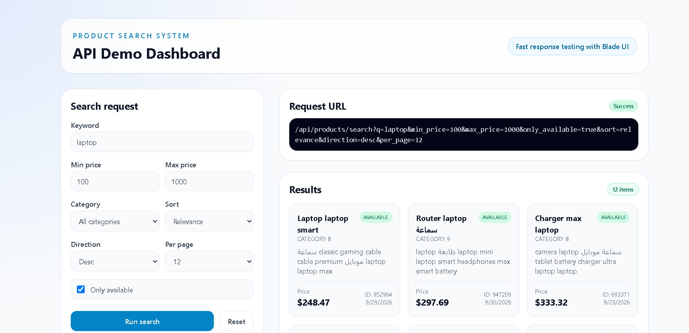

# Product Search System



A Laravel-based product search API designed for large datasets, advanced filtering, flexible sorting, and paginated responses.

> The project is already prepared for a dataset of 1,000,000 products. The focus is on database-driven performance, proper indexing, and searching without loading all rows into memory.

## Overview

This project provides a product search API with:

- Name and description search
- Price range filters
- Category filter
- Only available products filter
- Sorting by price or created date
- Pagination with a maximum of 50 results per page
- Validation for empty and invalid inputs
- JSON envelope for both success and error responses

## Features implemented

### Main endpoint

- GET /api/products/search
- GET /api/v1/products/search

### Supported query parameters

- q: search text across product name and description
- min_price: minimum price
- max_price: maximum price
- category_id: category filter
- only_available: true/false filter
- sort: relevance | price | created_at
- direction: asc | desc
- per_page: items per page, capped at 50
- page: page number

### Behavior

- Empty search returns the normal product listing
- Invalid numeric values and invalid enum values are rejected with 422
- Missing resources return a unified error envelope
- Relevance sorting falls back to created_at when no query is provided

## Architecture

```text
app/
  Actions/
    Products/
      SearchProductsAction.php
  DTOs/
    ProductSearchData.php
  Enums/
    ProductSortField.php
    SortDirection.php
  Exceptions/
    ApiExceptionHandler.php
  Http/
    Controllers/
      Api/
        ProductSearchController.php
    Requests/
      Api/
        ProductSearchRequest.php
    Resources/
      ProductResource.php
    Traits/
      ApiResponse.php
  Models/
    Category.php
    Product.php
  Services/
    CategoryCache.php
    ProductSearchService.php
  Support/
    SearchTermParser.php
```

### Why this structure is effective

- Controller: handles request entry
- Request: validates and normalizes input
- Action: orchestrates business logic
- Service: builds the database query
- Model: encapsulates query scopes and relationships
- Resource: shapes JSON output
- Exception handler: standardizes API error output

## Database design

### Tables

#### categories

- id
- name
- slug
- timestamps

#### products

- id
- category_id
- name
- description
- price
- is_available
- created_at
- updated_at

### Indexes included

- FULLTEXT index on name + description
- Composite index on category_id + is_available + price
- Composite index on category_id + is_available + created_at
- Index on price
- Index on created_at
- Unique index on categories.slug

### Performance strategy

For a one-million-record dataset, the most important rule is to avoid loading all rows into the application memory. This project keeps the heavy work in the database by using:

- SQL-level filtering
- SQL-level sorting
- SQL-level pagination
- FULLTEXT search
- targeted indexes for filter combinations

## Search logic

### Text parsing

The system normalizes input through SearchTermParser, which:

- strips unsupported punctuation
- lowercases the term
- splits it into tokens
- removes noise
- prepares boolean full-text queries when possible

### Fallback behavior

If the search input is too short or cannot be used in full-text search, the code falls back to safe LIKE-based matching against both the product name and description.

This avoids breaking searches such as:

- q=tv
- q=usb
- q=box

while still keeping the query efficient and database-driven.

## API response format

### Success response

```json
{
    "success": true,
    "message": "Products retrieved successfully.",
    "data": [
        {
            "id": 15,
            "name": "Gaming Laptop",
            "description": "High-performance gaming laptop",
            "price": 429.99,
            "is_available": true,
            "category": {
                "id": 3,
                "name": "Electronics",
                "slug": "electronics"
            },
            "created_at": "2026-10-12T10:00:00+00:00"
        }
    ],
    "meta": {
        "pagination": {
            "current_page": 1,
            "per_page": 10,
            "count": 10,
            "has_more": true,
            "next_page_url": "http://localhost:8000/api/products/search?q=laptop&page=2",
            "prev_page_url": null
        }
    }
}
```

### Validation error response

```json
{
    "success": false,
    "message": "The given data was invalid.",
    "data": null,
    "errors": {
        "per_page": ["The per page value may not exceed 50."]
    }
}
```

### Not found response

```json
{
    "success": false,
    "message": "Resource not found.",
    "data": null
}
```

## Response speed and Postman testing guidance

To keep response times fast in Postman and in production:

- Use narrow filters whenever possible
- Prefer specific category_id and price ranges
- Keep per_page under 50
- Avoid unnecessary broad queries without q
- Use the database indexes already configured
- Keep the query term focused and relevant

### Example Postman request

```http
GET /api/products/search?q=laptop&category_id=3&min_price=100&max_price=500&only_available=true&sort=price&direction=asc&per_page=12
```

### Performance notes

For large datasets, the biggest gains come from:

1. proper indexing
2. keeping search and filtering in SQL
3. limiting result size via pagination
4. avoiding broad full scans in application code

This implementation follows those principles.

### Latest performance upgrade

The search flow was tuned to respond faster in real usage:

- default pagination was reduced from 15 to 10 results to reduce database workload
- extra composite indexes were added for high-frequency filter/sort patterns
- the API still keeps SQL-based filtering and sorting instead of loading all products in memory

For an existing local database, run:

```bash
php artisan migrate
```

to apply the new search indexes.

## Quick Blade API demo

The project now includes a light Blade-based testing dashboard for the API.

Open the app in the browser:

```bash
php artisan serve
```

Then visit:

- http://localhost:8000

The page includes:

- search form for q, category, price range, stock status, sort, direction, and page size
- real-time API request preview
- response cards for products
- raw JSON output for debugging and Postman-style validation
- a clean modern design for quick manual testing without external tools

This is useful when you want to validate the search behavior visually before sending requests from Postman or another client.

## Local setup

### Install dependencies

```bash
composer install
npm install
```

### Environment and database

```bash
cp .env.example .env
php artisan key:generate
php artisan migrate
php artisan db:seed
```

### Run app

```bash
php artisan serve
```

### Run tests

```bash
php artisan test
```

## Key project files

- routes/api.php: API routes
- app/Http/Requests/Api/ProductSearchRequest.php: validation and normalization
- app/Services/ProductSearchService.php: search query builder
- app/Models/Product.php: query scopes
- app/Support/SearchTermParser.php: input normalization and search token handling
- app/Http/Traits/ApiResponse.php: JSON envelope formatting
- app/Exceptions/ApiExceptionHandler.php: unified error handling
- database/migrations/2026_10_11_185226_create_products_table.php: product schema and indexes

## Production-level improvements to consider

If this project evolves into a production-scale e-commerce platform, these are the next improvements worth considering:

- Redis cache for frequent search patterns
- Elasticsearch/OpenSearch for advanced search rank tuning
- dedicated search index for product names and descriptions
- rate limiting
- request logging and monitoring
- CDN or cache layer for read-heavy product listings

## Summary

This project is built around a strong database-first search approach, a clean Laravel architecture, and a clear standardized API contract. It is designed to work efficiently with large product catalogs while keeping the application logic maintainable and production-friendly.

---

Prepared for Product Search System
